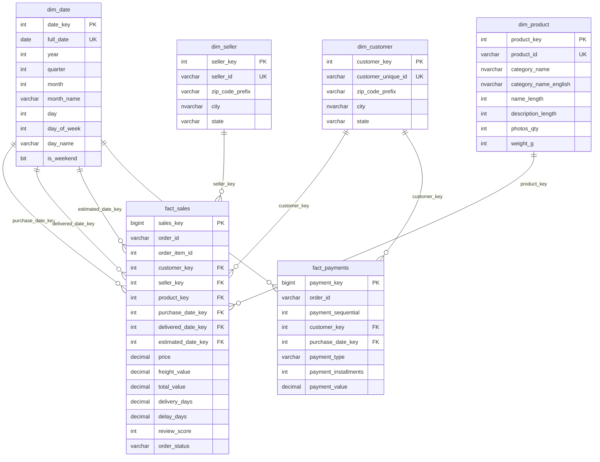

# Olist Cloud Data Warehouse & Analytics Pipeline

[](https://www.python.org/)
[](https://azure.microsoft.com/)
[](tests/)
[](docs/architecture.md)
[](LICENSE)

An enterprise-grade, end-to-end e-commerce data warehouse built on the **Brazilian E-Commerce Public Dataset by Olist** (~100k orders). The pipeline cleans, validates, stages, and models multi-relational data into a star schema hosted on **Azure Blob Storage / ADLS Gen2** and **Azure SQL Database**.

---

## 1. Project Overview & Business Problem

### Business Context
Olist operates a marketplace connecting small Brazilian merchants to major e-commerce channels. Managing fulfillment across Brazil’s continental geography introduces acute logistical challenges: delivery delays, regional cost disparities, and cross-state tax variations directly degrade customer satisfaction (CSAT) and seller retention.

### Technical Problem
The raw data is dispersed across **9 relational CSV files** with real-world data imperfections:
- Inconsistent timestamps across multiple order stages.
- Misspelled schema column names (`lenght`).
- Ephemeral order tokens masquerading as customer keys.
- Multiple duplicate reviews per order.
- Massive geolocation coordinates per zip code prefix.

### Solution
This project implements an automated, fault-tolerant ELT pipeline:
1. **Ingests** raw CSVs into an Azure Blob Storage Data Lake (`raw` container).
2. **Transforms & cleans** data via vectorized Pandas operations into typed **Apache Parquet** columnar files.
3. **Validates data quality** using a strict suite of business rules and referential integrity checks with multi-error collection.
4. **Bulk-loads staging tables** in Azure SQL Database using SQLAlchemy and `fast_executemany=True`.
5. **Models a Kimball Star Schema** (`dw` schema) using idempotent `MERGE` and `INSERT ... WHERE NOT EXISTS` statements wrapped in ACID transactions.
6. **Delivers business intelligence views** and advanced analytical queries using CTEs and window functions (`LAG`, `RANK`, `DENSE_RANK`, `SUM() OVER`).

---

## 2. End-to-End Pipeline Architecture

```mermaid
flowchart TD
    subgraph Ingestion["1. Ingestion Layer"]
        Kaggle["Olist Kaggle Dataset<br/>(9 CSV Files)"]
        RawLocal["data/raw/"]
        AzureRaw["Azure Blob Storage<br/>(Container: raw)"]
        Kaggle --> RawLocal
        RawLocal -->|src/ingest.py| AzureRaw
    end

    subgraph Cleaning["2. Processing & Quality Layer"]
        Cleaner["src/clean.py<br/>- 5 Timestamp Parsers<br/>- Zip Aggregation (Mean Coords)<br/>- Translation Join & Fallback<br/>- Keep Latest Review"]
        Parquet["Cleaned Parquet Files<br/>(data/processed/)"]
        Validator["src/validate.py<br/>- Duplicate order_id<br/>- Null timestamps<br/>- Negative price/freight<br/>- FK Referential Integrity<br/>- Review score in [1, 5]"]
        AzureProc["Azure Blob Storage<br/>(Container: processed)"]

        RawLocal --> Cleaner
        Cleaner --> Parquet
        Parquet --> Validator
        Parquet -.->|Optional Upload| AzureProc
    end

    subgraph Staging["3. Staging Schema (staging.*)"]
        Stg["Azure SQL Database<br/>- stg_orders, stg_order_items<br/>- stg_order_payments, stg_order_reviews<br/>- stg_products, stg_customers<br/>- stg_sellers, stg_geolocation"]
        Validator -->|src/load_staging.py<br/>fast_executemany=True| Stg
    end

    subgraph Warehouse["4. Dimensional Model (dw.*)"]
        DimDate["dw.dim_date (Recursive CTE)"]
        DimCust["dw.dim_customer (customer_unique_id)"]
        DimSeller["dw.dim_seller"]
        DimProd["dw.dim_product (PT & EN)"]
        FactSales["dw.fact_sales (Grain: Order Item)"]
        FactPay["dw.fact_payments (Grain: Payment)"]

        Stg -->|04_load_dimensions.sql (MERGE)| DimDate
        Stg -->|04_load_dimensions.sql (MERGE)| DimCust
        Stg -->|04_load_dimensions.sql (MERGE)| DimSeller
        Stg -->|04_load_dimensions.sql (MERGE)| DimProd
        Stg -->|05_load_facts.sql (WHERE NOT EXISTS)| FactSales
        Stg -->|05_load_facts.sql (WHERE NOT EXISTS)| FactPay
    end

    subgraph Analytics["5. Analytics & Views"]
        Views["dw.vw_monthly_revenue<br/>dw.vw_seller_performance<br/>dw.vw_delivery_performance"]
        Queries["sql/07_analysis_queries.sql<br/>- MoM Growth (LAG)<br/>- Top 3 Sellers/State (RANK)<br/>- Repeat Customer Rate<br/>- Cumulative Revenue"]
        FactSales --> Views
        FactPay --> Views
        Views --> Queries
    end
```

---

## 3. Tech Stack

| Component | Technology | Rationale |
| :--- | :--- | :--- |
| **Language** | Python 3.10+ | Standard data engineering scripting, native type hints, and rich ecosystem. |
| **Data Processing** | pandas, pyarrow | High-performance columnar processing and Parquet serialization. |
| **Database ORM** | SQLAlchemy, pyodbc | Python SQL toolkit configured with `fast_executemany=True` for high-throughput batch loads. |
| **Cloud Storage** | Azure Blob / ADLS Gen2 | Scalable, tierable object storage for raw CSVs and processed Parquet. |
| **Cloud Warehouse** | Azure SQL Database (T-SQL) | Managed relational database engine supporting ACID transactions, MERGE, and window functions. |
| **Testing** | pytest | Unit testing framework validating cleaning logic and data quality rules against in-memory DataFrames. |
| **Orchestration** | Python CLI / Azure Data Factory | Modular execution script with local-only fallback; ADF pipeline ready. |

---

## 4. Dataset Quirks & Cleaning Rules

| Dataset | Raw Quirk Identified | Engineering Solution Applied in `src/clean.py` |
| :--- | :--- | :--- |
| **`orders`** | 5 mixed timestamp columns; canceled/shipped orders lack delivery dates; duplicate order IDs. | Parsed with `pd.to_datetime(..., errors="coerce")`; deduplicated on `order_id`; derived `delivery_days = (delivered - purchase)` and `delay_days = (delivered - estimated)`. |
| **`products`** | Misspelled columns (`product_name_lenght`, `product_description_lenght`); Portuguese categories without English translations. | Renamed misspelled columns to `..._length`; left joined `product_category_name_translation.csv`; imputed missing and unmapped categories with `"unknown"`. |
| **`reviews`** | Multiple reviews submitted per order across time (e.g., initial complaint followed by resolution). | Sorted by `review_answer_timestamp` ascending, then deduplicated on `order_id` keeping the latest (`keep="last"`). |
| **`geolocation`** | Hundreds of redundant coordinate records per 5-digit zip code prefix. | Grouped by `geolocation_zip_code_prefix`, computing mean `lat`/`lng` and picking first `city`/`state`. |
| **`customers`** | `customer_id` is a transient order-level ID, obscuring buyer identity. | Preserved `customer_id` for order foreign keys while elevating `customer_unique_id` as the true business key. |
| **`sellers`, `items`, `payments`** | Exact duplicate rows caused by transaction replays. | Purged exact duplicate records using `.drop_duplicates()`. |

---

## 5. Star Schema Design (Kimball Dimensional Model)



### Fact Table Grain & Integrity
- **`dw.fact_sales`**: **One row per order item**. Unique constraint on `(order_id, order_item_id)`. Includes nonclustered indexes on `purchase_date_key`, `product_key`, `seller_key`, and `customer_key`.
- **`dw.fact_payments`**: **One row per payment installment**. Unique constraint on `(order_id, payment_sequential)`.
- **`dw.dim_date`**: Pre-populated using a recursive CTE spanning 2016 to 2019 (1,461 calendar days) with flags for quarters, day names, and weekend detection.

---

## 6. Step-by-Step Setup Guide

### Step 1: Azure Storage Account Setup
1. Log in to the [Azure Portal](https://portal.azure.com/).
2. Create a Storage Account (e.g., `stolistdwprod01`, Standard General Purpose v2).
3. Under **Data storage > Containers**, create two private containers:
   - `raw`
   - `processed`
4. Under **Security + networking > Access keys**, copy the **Connection string**.

### Step 2: Azure SQL Database Setup
1. In Azure Portal, create an **Azure SQL Database** (e.g., `olist_dw` on server `sql-olist-dw.database.windows.net`).
2. Compute tier: Serverless (General Purpose, 1 vCore) is cost-effective for portfolio projects.
3. Record your SQL admin username and password.

### Step 3: Firewall Configuration
1. On your SQL Server page, navigate to **Security > Networking**.
2. Enable **"Allow Azure services and resources to access this server"**.
3. Under **Firewall rules**, add your client IPv4 address and click **Save**.

### Step 4: Install ODBC Driver 18 for SQL Server
- **Windows**: Download and run the official [Microsoft ODBC Driver 18 for SQL Server (x64)](https://learn.microsoft.com/en-us/sql/connect/odbc/download-odbc-driver-for-sql-server).
- **Linux/macOS**:
  ```bash
  # Ubuntu / Debian
  sudo apt-get install -y msodbcsql18 unixodbc-dev
  # macOS (Homebrew)
  brew tap microsoft/mssql-release https://github.com/Microsoft/homebrew-mssql-release
  brew update && brew install msodbcsql18
  ```

### Step 5: Environment & Dependencies
Clone the repository and install dependencies:
```bash
# Clone repository
git clone https://github.com/your-username/olist-data-warehouse.git
cd olist-data-warehouse

# Install Python requirements
pip install -r requirements.txt

# Configure environment variables
cp .env.example .env
```
Populate `.env` with your Azure credentials:
```env
AZURE_STORAGE_CONNECTION_STRING="DefaultEndpointsProtocol=https;AccountName=...;AccountKey=...;EndpointSuffix=core.windows.net"
AZURE_CONTAINER_RAW="raw"
AZURE_CONTAINER_PROCESSED="processed"

AZURE_SQL_SERVER="sql-olist-dw.database.windows.net"
AZURE_SQL_DATABASE="olist_dw"
AZURE_SQL_USER="cloudadmin"
AZURE_SQL_PASSWORD="YourStrongPassword123!"
AZURE_SQL_PORT=1433
AZURE_SQL_DRIVER="ODBC Driver 18 for SQL Server"
```

---

## 7. How to Run the Pipeline

### Mode A: Local Execution (Offline / Synthetic Data)
Test the entire data cleaning, transformation, and validation pipeline locally without connecting to Azure:
```bash
python -m src.run_pipeline --local-only --generate-sample
```
What this does:
1. Generates 50 realistic synthetic orders across all 9 Olist tables into `data/raw/`.
2. Cleans raw datasets and writes columnar Parquet files into `data/processed/`.
3. Executes 7 data quality validation checks with detailed logs.

### Mode B: Full Cloud Pipeline (Azure Blob + Azure SQL)
Download the [Kaggle Olist Dataset](https://www.kaggle.com/datasets/olistbr/brazilian-ecommerce) CSVs into `data/raw/` and execute:
```bash
python -m src.run_pipeline
```
What this does:
1. Ingests raw CSVs to Azure Blob Storage `raw` container (with 3-attempt exponential backoff).
2. Cleans datasets into Parquet and uploads to `processed` container.
3. Runs data quality validation suite (halts pipeline if errors exist).
4. Bulk loads Parquet into Azure SQL `staging` schema using `fast_executemany=True`.
5. Executes T-SQL scripts `01` through `06` to build schemas, tables, dimensions, facts, and views.

### Running Automated Tests
```bash
pytest -v
```

---

## 8. Sample Pipeline Results & Performance Benchmarks

| Pipeline Stage | Entity / Table | Synthetic Dataset (50 Orders) | Full Kaggle Dataset (~100k Orders) |
| :--- | :--- | :--- | :--- |
| **Ingestion** | 9 Raw CSV Files | 0.45s (Local) | ~18s (Azure Blob) |
| **Cleaning** | `orders` | 50 rows (0.02s) | 99,441 rows (~1.8s) |
| **Cleaning** | `order_items` | 71 rows (0.01s) | 112,650 rows (~1.2s) |
| **Cleaning** | `products` | 21 rows (0.01s) | 32,951 rows (~0.6s) |
| **Cleaning** | `customers` | 50 rows (0.01s) | 99,441 rows (~0.9s) |
| **Cleaning** | `sellers` | 10 rows (0.01s) | 3,095 rows (~0.2s) |
| **Cleaning** | `geolocation` | 10 rows (0.01s) | 19,015 aggregated zip codes (~2.1s) |
| **Validation** | Data Quality Suite | 7/7 Passed (0.03s) | 7/7 Passed (~0.8s) |
| **Staging Load** | `staging.stg_*` | 8 tables (~0.05s) | ~38s (fast_executemany) |
| **Dimension Load** | `dw.dim_*` (MERGE) | ~0.15s | ~12s |
| **Fact Load** | `dw.fact_sales` | 71 rows (~0.12s) | 112,650 rows (~14s) |
| **Total Runtime**| End-to-End Pipeline | **< 1 second** | **~90 seconds** |

---

## 9. Analytical SQL Queries Showcase

Located in [`sql/07_analysis_queries.sql`](sql/07_analysis_queries.sql):

```sql
-- Query 1 Preview: Monthly Revenue and Month-over-Month (MoM) Growth
WITH MonthlySales AS (
    SELECT
        d.year,
        d.month,
        d.month_name,
        (d.year * 100) + d.month AS year_month_key,
        SUM(fs.total_value) AS current_month_revenue,
        COUNT(DISTINCT fs.order_id) AS total_orders
    FROM dw.fact_sales fs
    INNER JOIN dw.dim_date d ON fs.purchase_date_key = d.date_key
    WHERE fs.order_status <> 'canceled'
    GROUP BY d.year, d.month, d.month_name, (d.year * 100) + d.month
)
SELECT
    year, month, month_name, current_month_revenue, total_orders,
    LAG(current_month_revenue, 1) OVER (ORDER BY year_month_key) AS previous_month_revenue,
    ROUND(
        (current_month_revenue - LAG(current_month_revenue, 1) OVER (ORDER BY year_month_key))
        * 100.0 / NULLIF(LAG(current_month_revenue, 1) OVER (ORDER BY year_month_key), 0),
        2
    ) AS mom_revenue_growth_pct
FROM MonthlySales
ORDER BY year_month_key;
```

Other analytical queries included:
- **Query 2**: Top 3 Sellers per State using `DENSE_RANK() OVER (PARTITION BY state ORDER BY revenue DESC)`.
- **Query 3**: Average Delivery Delay and Review Score correlation by Customer State.
- **Query 4**: Top 10 Product Categories by revenue with percentage share of enterprise total using `SUM() OVER ()`.
- **Query 5**: Repeat-customer rate and LTV analysis by `customer_unique_id`.
- **Query 6**: Cumulative revenue by month using running total `SUM() OVER (ORDER BY ... ROWS BETWEEN UNBOUNDED PRECEDING AND CURRENT ROW)`.
- **Query 7**: Late delivery binned buckets vs. 5-star / 1-star CSAT distribution.
- **Query 8**: Revenue by day of week and weekend vs. weekday.

---

## 10. Key Learnings & Future Enhancements

1. **Orchestration with Azure Data Factory (ADF)**:
   - In production, replace `run_pipeline.py` with an ADF Pipeline triggered via Event Grid upon new file arrival in Azure Blob Storage.
   - Use ADF Web / Batch activities or Azure Functions to invoke the Python cleaning container, followed by an Execute Pipeline activity running stored procedures.
2. **Slowly Changing Dimensions (SCD Type 2)**:
   - While `dim_customer` and `dim_seller` currently use Type 1 (overwrite via `MERGE`), sellers frequently change warehouse locations. Implementing SCD Type 2 with `valid_from`, `valid_to`, and `is_current` flags would preserve historical fulfillment attribution.
3. **Data Transformation with dbt**:
   - Migrate SQL scripts `02` through `06` into a `dbt-sqlserver` project to achieve declarative lineage graphs, automated schema documentation, and built-in generic tests (`unique`, `not_null`, `relationships`).
4. **Semantic Layer & Power BI**:
   - Connect Power BI via DirectQuery / Import to the `dw` schema, utilizing predefined DAX measures for Revenue, Average Order Value (AOV), and Net Promoter Score (NPS).

---

## License
MIT License. Created for portfolio demonstration and production reference.
