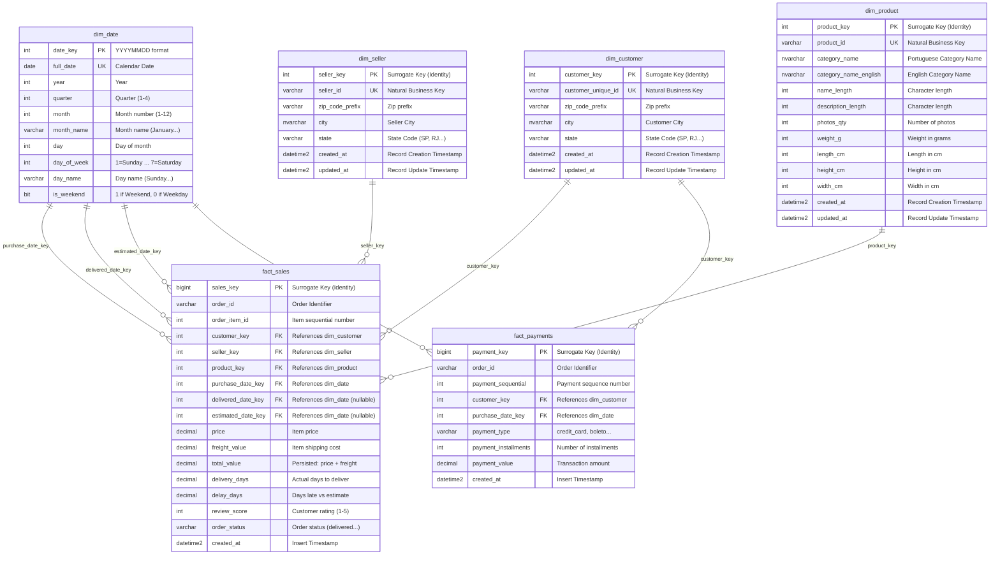

# Olist Data Warehouse Architecture & Dimensional Design

## 1. End-to-End Pipeline Architecture

The **olist-data-warehouse** is designed as a modern ELT/ETL hybrid data pipeline combining **Python** for file processing and data quality validation, **Azure Blob Storage / ADLS Gen2** for cloud data lake storage, and **Azure SQL Database** for dimensional warehousing and analytical querying.

```mermaid
flowchart TD
    subgraph Data_Source["1. Ingestion Layer"]
        Kaggle["Kaggle Olist Dataset<br/>(9 CSV Files)"]
        LocalRaw["Local Disk<br/>(data/raw/)"]
        AzureRaw["Azure Blob Storage<br/>(Container: raw)"]
        Kaggle --> LocalRaw
        LocalRaw -->|src/ingest.py| AzureRaw
    end

    subgraph Transformation_Layer["2. Cleaning & Validation Layer"]
        Clean["src/clean.py<br/>- Timestamp Parsing (5 cols)<br/>- Geo Aggregation (mean lat/lng)<br/>- Category Translation Join<br/>- Review Deduplication (keep latest)<br/>- Exact Deduplication"]
        Validate["src/validate.py<br/>(Data Quality Suite)<br/>- Duplicate order_id check<br/>- Null timestamp check<br/>- Price & freight > 0<br/>- Referential Integrity FKs<br/>- Review scores in [1, 5]"]
        Parquet["Cleaned Parquet Files<br/>(data/processed/)"]
        AzureProc["Azure Blob Storage<br/>(Container: processed)"]

        LocalRaw --> Clean
        Clean --> Parquet
        Parquet --> Validate
        Parquet -.->|Optional Upload| AzureProc
    end

    subgraph Staging_Layer["3. Staging Layer (Azure SQL)"]
        StgTables["Staging Schema (staging.*)<br/>- stg_orders<br/>- stg_order_items<br/>- stg_order_payments<br/>- stg_order_reviews<br/>- stg_products<br/>- stg_customers<br/>- stg_sellers<br/>- stg_geolocation"]
        Validate -->|src/load_staging.py<br/>SQLAlchemy + fast_executemany| StgTables
    end

    subgraph Warehouse_Layer["4. Star Schema Dimensional Warehouse (dw.*)"]
        DimDate["dw.dim_date<br/>(2016-2019 Recursive CTE)"]
        DimCust["dw.dim_customer<br/>(Keyed on customer_unique_id)"]
        DimSeller["dw.dim_seller"]
        DimProd["dw.dim_product<br/>(PT & EN Categories)"]
        FactSales["dw.fact_sales<br/>(Grain: 1 row per order item)"]
        FactPay["dw.fact_payments<br/>(Grain: 1 row per payment)"]

        StgTables -->|04_load_dimensions.sql (MERGE)| DimDate
        StgTables -->|04_load_dimensions.sql (MERGE)| DimCust
        StgTables -->|04_load_dimensions.sql (MERGE)| DimSeller
        StgTables -->|04_load_dimensions.sql (MERGE)| DimProd

        StgTables -->|05_load_facts.sql (INSERT WHERE NOT EXISTS)| FactSales
        StgTables -->|05_load_facts.sql (INSERT WHERE NOT EXISTS)| FactPay

        DimDate -.-> FactSales
        DimCust -.-> FactSales
        DimSeller -.-> FactSales
        DimProd -.-> FactSales

        DimDate -.-> FactPay
        DimCust -.-> FactPay
    end

    subgraph Analytics_Layer["5. Analytics & Business Intelligence"]
        Views["dw.vw_monthly_revenue<br/>dw.vw_seller_performance<br/>dw.vw_delivery_performance"]
        Queries["sql/07_analysis_queries.sql<br/>- MoM Revenue Growth (LAG)<br/>- Top 3 Sellers/State (RANK)<br/>- Repeat Customer Rate<br/>- Cumulative Revenue (SUM OVER)"]
        PowerBI["BI & Dashboards<br/>(Power BI / Excel / Tableau)"]

        FactSales --> Views
        FactPay --> Views
        Views --> Queries
        Views --> PowerBI
    end

    classDef source fill:#E1F5FE,stroke:#0288D1,stroke-width:2px;
    classDef transform fill:#FFF3E0,stroke:#F57C00,stroke-width:2px;
    classDef staging fill:#EDE7F6,stroke:#512DA8,stroke-width:2px;
    classDef warehouse fill:#E8F5E9,stroke:#388E3C,stroke-width:2px;
    classDef analytics fill:#FCE4EC,stroke:#C2185B,stroke-width:2px;

    class Kaggle,LocalRaw,AzureRaw source;
    class Clean,Validate,Parquet,AzureProc transform;
    class StgTables staging;
    class DimDate,DimCust,DimSeller,DimProd,FactSales,FactPay warehouse;
    class Views,Queries,PowerBI analytics;
```

---

## 2. Dimensional Data Model (Star Schema)

The analytical data warehouse follows Kimball star schema principles to optimize analytical query throughput, minimize JOIN complexity, and enable drill-down slice-and-dice reporting.



---

## 3. Dimensional Modeling Design Decisions

### 3.1 Grains Defined
- **`dw.fact_sales`**: **One row per order item**. An order in Olist may contain multiple items across distinct products and sellers. Maintaining the item-level grain ensures zero loss of detail, enabling accurate product-level and seller-level margin calculations.
- **`dw.fact_payments`**: **One row per payment installment/sequential transaction**. Enables financial reconciliation against total order value and analysis of payment methods (credit card installments vs. cash boleto).

### 3.2 Handling Customer Entities (`customer_id` vs `customer_unique_id`)
In the raw Olist dataset, `customer_id` is an ephemeral token generated per order. The true real-world entity is `customer_unique_id`. Modeling `dim_customer` keyed on `customer_unique_id` allows accurate calculation of **repeat purchase rates**, **customer lifetime value (CLV)**, and cohort retention.

### 3.3 Role-Playing Date Dimensions
`dw.fact_sales` references `dw.dim_date` through three distinct foreign key roles:
1. `purchase_date_key`: When the customer checked out.
2. `delivered_date_key`: When the carrier handed the package to the customer (nullable for shipped/canceled orders).
3. `estimated_date_key`: The SLA promised delivery deadline.

### 3.4 Idempotency & Re-Run Safety
1. **Dimensions (`04_load_dimensions.sql`)**: Uses `MERGE ... WHEN MATCHED THEN UPDATE ... WHEN NOT MATCHED THEN INSERT`. Re-running does not produce duplicate surrogate keys.
2. **Facts (`05_load_facts.sql`)**: Uses `INSERT ... WHERE NOT EXISTS (SELECT 1 FROM dw.fact_sales WHERE order_id = oi.order_id AND order_item_id = oi.order_item_id)`. Re-running does not create duplicate transactions.
3. **Staging Ingestion**: Truncated prior to every reload (`TRUNCATE TABLE staging.stg_*`).

### 3.5 Bulk Ingestion Performance
- Staging loads leverage SQLAlchemy with `mssql+pyodbc` and `fast_executemany=True`.
- Inserts are executed in batches of `5,000` rows, reducing network round-trips from minutes to seconds.
